# Prog Workshop
## *<ins>♦ Ex 1 : Ne garder que le vert</ins>*
Passage des canaux rouge et bleu à 0. (pas besoin des x et y)

## *<ins>♦ Ex 2 : Échanger les canaux</ins>*
Utilisation de std::swap(color.g, color.b) pour échanger les canaux vert et bleu.
Sinon manuellement on doit mémoriser les composantes de chaque pixel avant de faire une modification pour ne pas perdre l'information.

## *<ins>♦ Ex 3 : Noir & Blanc</ins>*
Il faut que tous les canaux soit égaux. Ou, la formule du gris est gris = 0.2126 * r + 0.7152 * g + 0.0722 * b

## *<ins>♦ Ex 4 : Négatif</ins>*
Création d'une base {1, 1, 1} pour ne représenter que le blanc (le max), puis on calcule la différence entre ce blanc et la couleur du pixel pour inverser la couleur.

## *<ins>♦ Ex 5 : Dégradé</ins>*
La nuance de gris va dépendre de x (la longueur). On parcours toute l'image en mettant chaque pixel avec les trois même canaux dépendant de x et de la longueur de l'image.

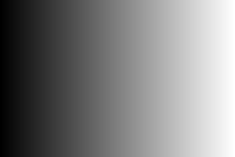

## *<ins>♦ Ex 6 : Miroir</ins>*
Parcours de la moitié de l'image en x (dans la longueur) et on utilise std::swap() pour interchanger le symétrique du pixel par rapport à la verticale qui passe au centre d l'image.

## *<ins>♦ Ex 7 : Image bruitée</ins>*
Utilisation des fonctions random fournies, ici true_with_probability et random_float pour choisir aléatoirement un pixel est changer ses couleurs de façon aussi aléatoire.

## *<ins>♦ Ex 8 : Rotation de 90°</ins>*
Mathématiquement, les axes sont interchangés lors d'une rotation à 90°.

## *<ins>♦ Ex 9 : RGB Split</ins>*
On crée une nouvelle image dans laquelle on va recopier les différents canaux de couleurs en ajoutant des contraintes.
Je fais un décalage de 15 pixels vers la droite pour le canal rouge et 15 vers la gauche pour le canal bleu. On doit mettre une condition de marge pour ne pas dépasser, qui sera donc ici de 15 pixels.

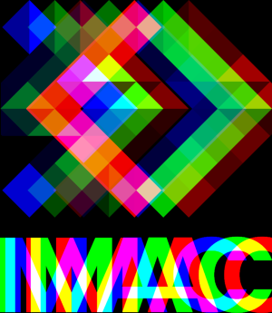

## *<ins>♦ Ex 10 : Luminosité</ins>*
- J'utilise la fonction carré pour assombrir l'image, en multipliant les canaux de chaque pixel par eux-mêmes.

- J'utilise la fonction std::pow() de la librairie cmath pour éclairer l'image. Il suffit de choisir un flottant inférieur à 1 pour avoir cet effet, ici 0.4f.

## *<ins>♦ Ex 11 : Disque</ins>*
Grace à l'équation d'un cercle adapté au centre de l'image n'étant pas l'origine, on peut mettre une condition sur le changement des pixels.
1 étant la valeur la plus forte de lumière.

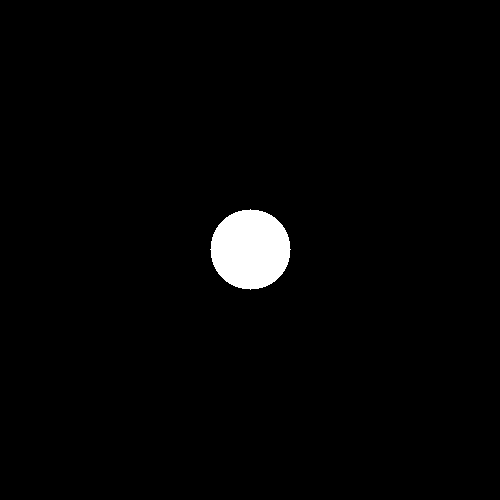

## *<ins>♦ Ex 12 : Cercle</ins>*
Le cercle fonctionne exactement de la même façon que le disque, on doit simplement rajouter une condition qui évolue en fonction de la thickness, pour créer un rebord. (l'intérieur de tout le disque n'est plus en blanc)

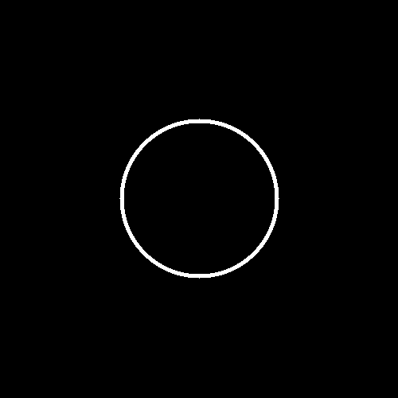

## *<ins>♦ Ex 13 : Animation</ins>*
J'ai adapté la fonction disque avec des paramètres pour pouvoir la réutiliser. Il ne reste plus qu'à se déplacer de quelques pixels et refaire un disque à chaque fois en sauvegardant bien chaque image et en recréant une nouvelle image à chaque itération sinon on garde les disques précédents.

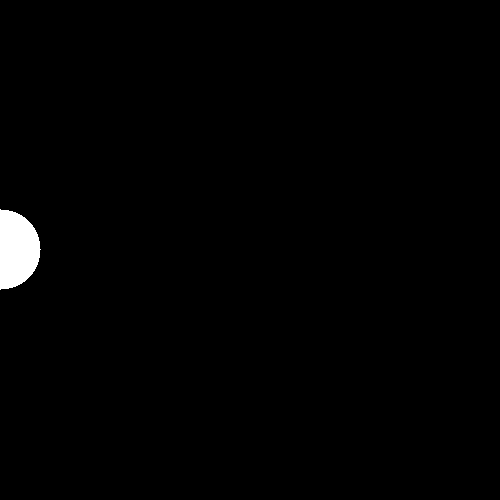

## *<ins>♦ Ex 14 : Rosace</ins>*
J'ai adapté la fonction cercle avec des paramètres pour pouvoir la réutiliser. J'ai voulu gérer le nombre de pétales donc je boucle sur ce dernier. Le calcul de l'angle se fait en radiant en divisant une tour complet c'est à dire 2*Pi par le nombre de pétales et l'angle augmentera au fil des itérations.
<ins>*Remarque*</ins> : std::cos et std::sin qui donne les coordonnées d'un point sur un cercle unitaire.

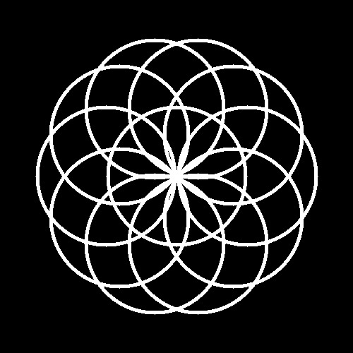

## *<ins>♦ Ex 15 : Mosaïque</ins>*
On a besoin de se servir du module (reste de la division euclidienne) pour adapter le parcours de la nouvelle image plus grande.

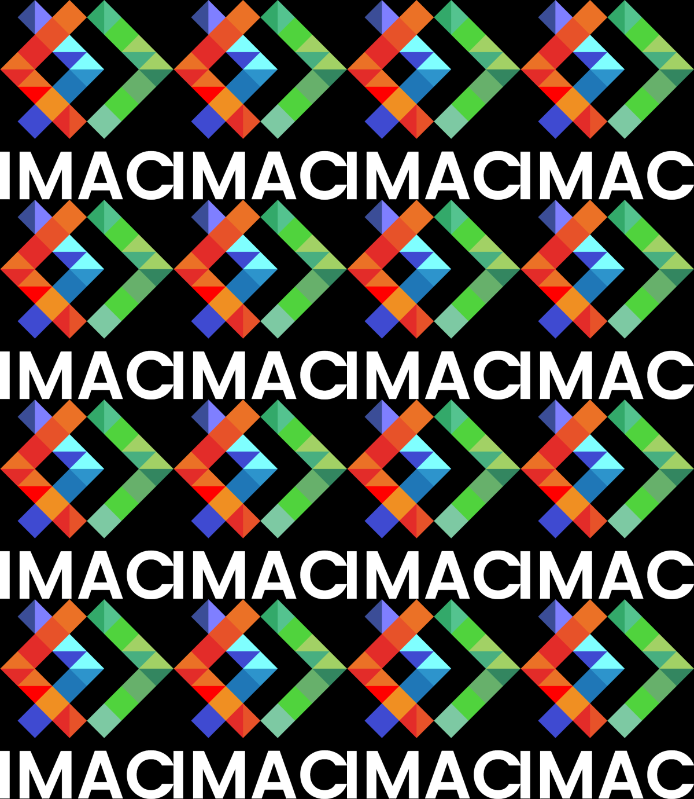

## *<ins>♦ Ex 16 : Mosaïque miroir</ins>*
On a besoin de savoir en fonction de la taille de l'image de base si on est sur une colonne paire pour recopier comme dans mosaïque. Sinon on recopie à l'envers.

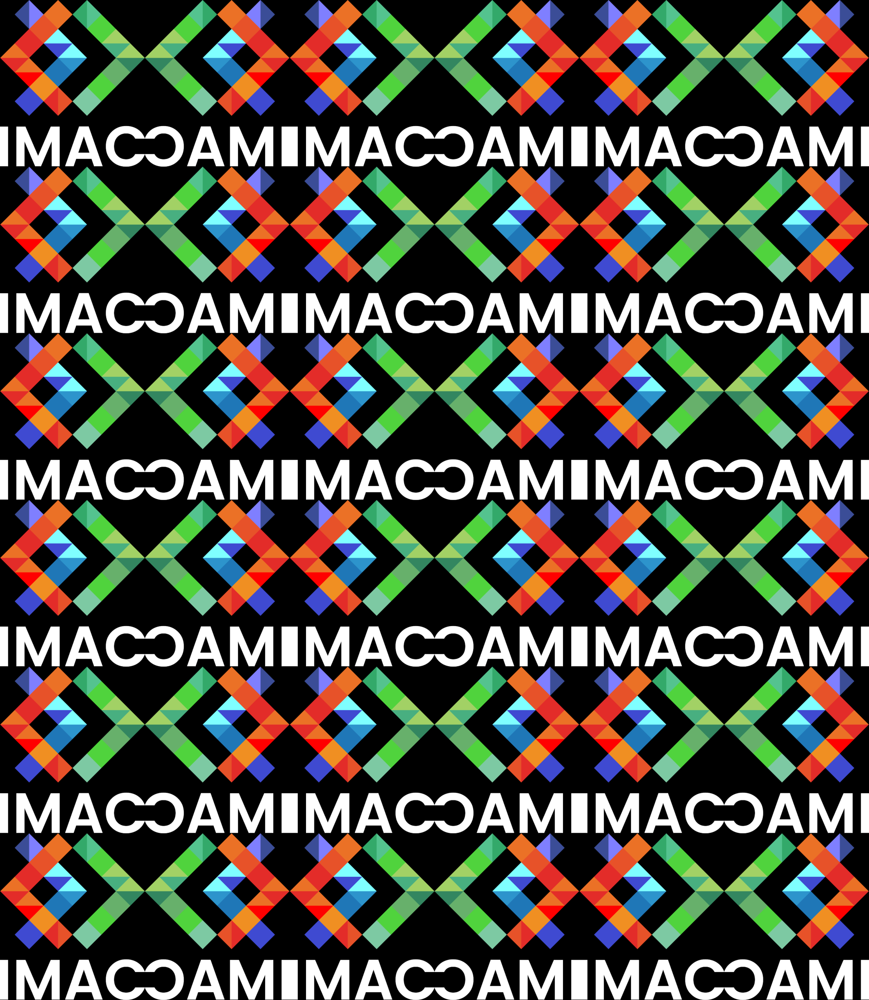

- Raté n°1 : (x/nb)%2 
Comme on divise 2 entier on a le reste de la division euclidienne modulo 2 cela explique qu'on est des bandes noirs espacé du même interval.
<ins>*Remarque*</ins> : Si nb augment alors l'espace deviendra plus grand.

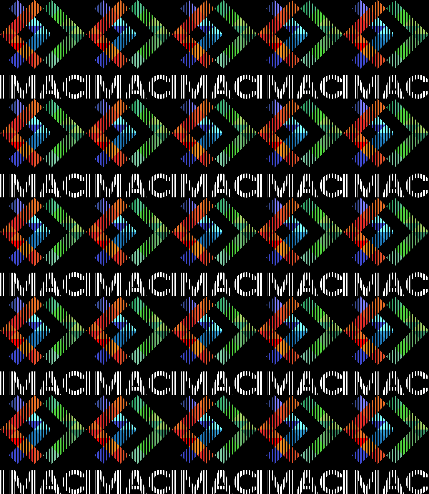

- Raté n°2 : Remplissage des espaces par les pixels de l'image de base.

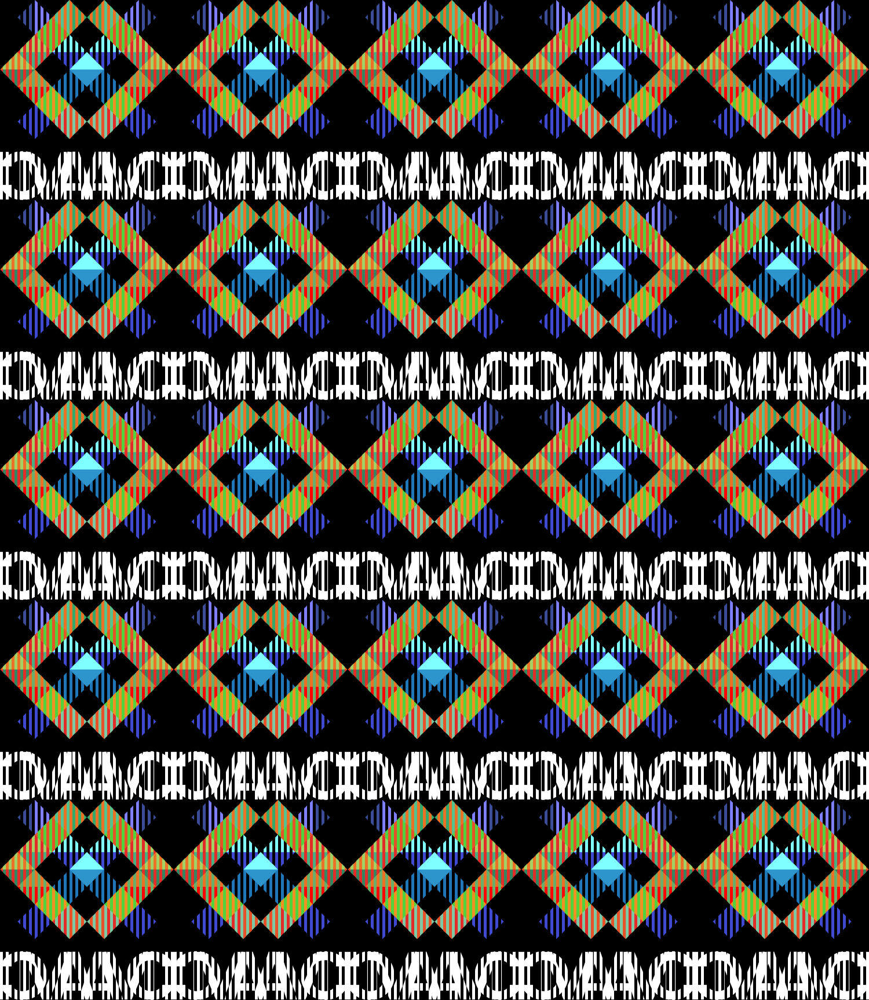

## *<ins>♦ Ex 17 : Glitch</ins>*
Probabilité très faible sinon l'image est trop susceptible de changer à chaque pixel et les modifications de se marcher dessus.
La marge des rectangles impose une condition sur le parcours complet de l'image.
Après j'utilise swap pour changer depuis le pixel actuel jusqu'au pixel actuel + la taille de mon rectangle.

## *<ins>♦ Ex 18 : Tri de pixels</ins>*
Je trie en récupérant d'abord les lignes puis les colonnes (on pourrait inverser le procédé pour obtenir un autre résultat). Puis on peut trier le tableau selon la condition que l'on veut, j'ai choisi ici le bleu.
Enfin je recopie le tableau ligne par ligne (on pourrait interchanger ici aussi ou choisir la façon dont on va disposer les pixels en introduisant une formule selon x, y).

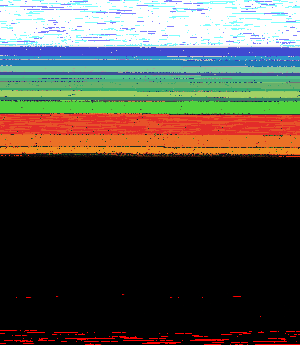

## *<ins>♦ Ex 19 : Fractale de Mandelbrot</ins>*

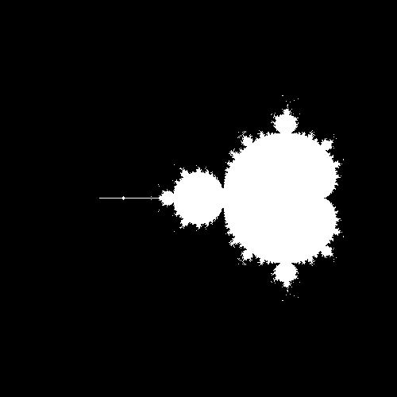

## *<ins>♦ Ex 20 : Convolution</ins>*
Je resize l'image avec une fonction crée pour dans le but de mieux voir l'effet de flou.
Ajout du'n double tableau pour gérer les différents kernel et réutiliser la même fonction de convolution.
- Box Blur

- Contour
